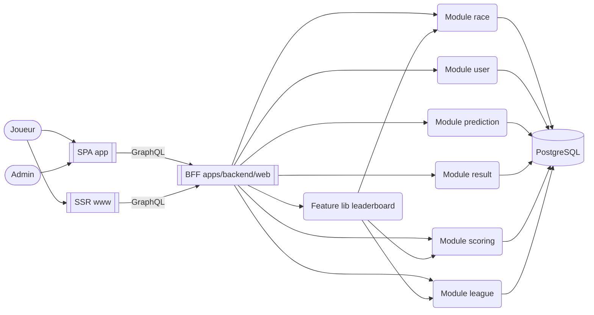

# Backend For Frontend (BFF)

## Principe

Le **Backend For Frontend** consiste à donner à chaque type de client un backend conçu pour ses besoins. Dans Fantrail, les clients web (SPA joueur et admin, homepage SSR) partagent un seul BFF : `apps/backend/web`.

Le BFF :

- expose l'API GraphQL des clients web ;
- orchestre les modules métier et agrège leurs données ;
- applique la sécurité propre à ses clients (session, rôle admin, limites de requêtes) ;
- garde un contrat d'API stable pour les fronts.

Le BFF **ne contient pas de logique métier** : elle vit dans les modules.

## Modules métier

Les modules (`libs/modules/<module>`) encapsulent chacun un domaine : courses, comptes, pronostics, résultats, scores, ligues. Ils sont :

- **agnostiques des clients** : aucun ne sait qu'il est servi en GraphQL ;
- **importés comme libs** par le BFF, dans un seul processus et une seule base PostgreSQL ;
- **découplés entre eux** : un module lit un autre module par ses queries, via un port de son domaine, jamais par ses tables.

Ce qui assemble plusieurs modules pour un besoin du BFF (un classement de ligue réunit ligue, courses et scores) vit dans une feature lib `libs/apps/backend/web/<feature>/feature-<nom>`.

## Responsabilités

| Couche                   | Responsabilités                                       |
| ------------------------ | ----------------------------------------------------- |
| Clients                  | UX, UI, logique de présentation                       |
| BFF (`apps/backend/web`) | Transport GraphQL, sécurité, composition              |
| Feature libs du BFF      | Assemblage de plusieurs modules pour un besoin client |
| Modules                  | Logique métier, règles fonctionnelles                 |
| Base de données          | Persistance et intégrité des données                  |

## Schéma

